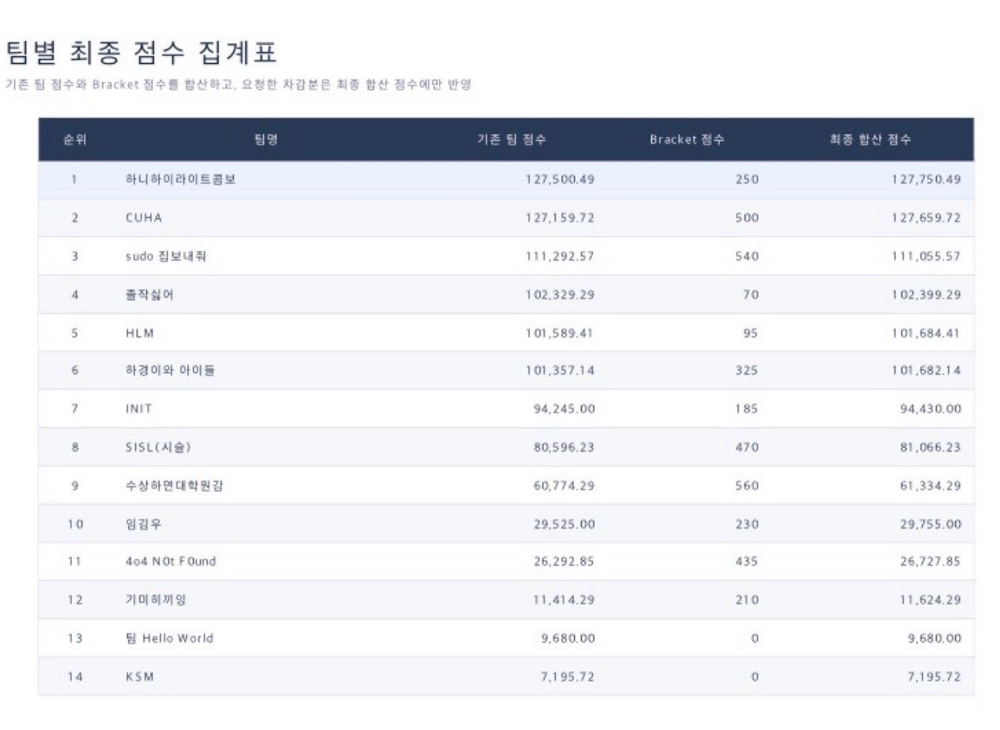

#### 들어가며

2026년 11월 20일부터 21일까지 진행된 **2026 충북 정보보호 해커톤(C-STRIKE)**에 참가하여 1등을 하게 되었다.

이번 대회는 일반적인 Jeopardy 방식의 CTF와 달리, 참가팀이 서로 공격과 방어를 동시에 수행하는 Attack & Defense(A&D) 방식으로 진행되었다.

처음 경험하는 A&D 대회였던 만큼 예상하지 못한 상황도 있었지만, 그 과정에서 많은 것을 배우고 팀원들과 함께 좋은 결과까지 얻을 수 있었다.

대회 문제와 풀이 과정은 공개에 제한이 있어 구체적인 Write-up 대신, 이번 글에서는 대회를 진행하면서 겪었던 일과 느낀 점을 정리해 보려고 한다.

#### 대회 진행 방식

이번 대회에는 총 15개 팀이 참가했으며, 모든 팀에 동일한 취약점이 포함된 서비스가 제공되었다.

각 팀은 자기 팀의 서비스를 방어하면서 동시에 다른 팀의 서비스를 공격하여 플래그를 획득해야 했다.

대회는 11월 20일 오후 7시부터 다음 날 오전 8시 30분까지 총 13시간 30분 동안 진행되었다. 1시간마다 새로운 문제가 하나씩 공개되었고, 2분마다 플래그가 갱신되었다.

자기 팀 서버에는 SSH를 통해 접속할 수 있었으며, 서비스의 소스 코드를 확인하고 취약점을 패치한 뒤 재배포할 수 있었다. 반면 상대 팀의 서비스는 제공된 IP와 포트를 통해 접근해야 했다.

즉, 단순히 취약점을 찾아 공격하는 것에서 끝나는 것이 아니라 상대 팀보다 빠르게 취약점을 분석하고 공격하면서, 자기 팀의 서비스도 정상적으로 유지해야 하는 대회였다.

우리 팀에서는 각자 역할을 나누어 진행했는데, 나는 평소 HTB를 통해 리눅스 환경의 모의해킹을 접해 본 경험이 있어 공격을 전담하게 되었다.

#### 시작부터 쉽지 않았던 첫 번째 문제

대회가 시작되고 첫 번째 문제가 공개되었다.

그런데 시작부터 예상하지 못한 문제가 있었다. 상대 팀의 서비스를 공격해야 하는데, 정작 상대 팀의 IP와 포트를 어디서 확인해야 하는지 제대로 파악하지 못했던 것이다.

결국 첫 문제가 공개된 뒤 약 30분 동안은 공격을 시작하지도 못한 채 헤매고 있었다.

그러던 중 문득 한 가지 생각이 떠올랐다.

"어차피 우리 팀과 상대 팀에 배포된 서비스가 똑같다면, 취약점도 똑같은 거 아닌가?"

모든 팀에 동일한 서비스가 배포된다면 취약점도 같을 것이고, 하나의 취약점에 대해 작성한 익스플로잇을 다른 팀에도 적용할 수 있을 것이라고 생각했다.

굳이 상대 팀의 서비스를 하나하나 분석하기보다는, 소스 코드를 직접 확인할 수 있는 우리 팀 서비스를 먼저 분석하는 것이 훨씬 효율적일 것 같았다.

또한 우리 팀 서비스의 구조와 연결 정보를 확인할 수 있었기 때문에 이를 바탕으로 자동화된 익스플로잇을 작성한다면 여러 팀의 플래그를 빠르게 획득할 수 있을 것이라고 판단했다.

평소 HTB에서 모의해킹 환경을 접했던 경험이 이러한 접근 방식을 떠올리는 데 어느 정도 영향을 주었던 것 같다.

이렇게 공격 방향을 정한 뒤 본격적으로 취약점 분석을 시작했다.

GPT와 Claude를 활용한 취약점 분석과 익스플로잇 작성

취약점 분석 과정에서는 웹 버전 GPT와 Claude에 CTF 분석용 스킬을 적용하여 보조 도구로 활용했다.

우리 팀 서비스의 소스 코드를 텍스트로 복사해 GPT와 Claude에 전달하고, 취약점 분석과 익스플로잇 코드 작성을 요청했다.

이후 GPT와 Claude가 제안한 익스플로잇 코드를 받아 직접 실행하면서 상대 팀 서비스에 공격을 시도했다.

그런데 예상했던 대로 플래그가 쫘라락 나오기 시작했다.

처음에는 상대 팀의 IP와 포트조차 찾지 못해 헤매고 있었는데, 접근 방식을 바꾼 이후에는 여러 팀의 플래그를 획득하면서 점수를 쌓을 수 있었다.

이때부터 A&D 대회에서 공격을 어떻게 진행해야 할지 감이 잡히기 시작했다.

물론 실제 취약점 분석과 익스플로잇 작성 과정에서는 GPT와 Claude의 도움을 많이 받았다. 하지만 동일한 서비스가 제공된다는 대회 환경의 특징을 활용해 분석 방향을 정했던 것이 효과적이었다고 생각한다.

이번 경험을 통해 모든 과정을 혼자 해결하는 것뿐만 아니라, 주어진 환경을 이해하고 어떤 방식으로 문제에 접근할지 판단하는 것도 중요하다는 것을 느꼈다.

공격만 잘한다고 끝나는 대회는 아니었다

처음에는 취약점을 분석하고 익스플로잇을 작성하여 플래그를 획득하는 데 집중했다.

하지만 A&D 대회에서는 공격뿐만 아니라 방어도 중요했다.

우리 팀의 서비스와 상대 팀의 서비스가 동일하다는 것은 내가 발견한 취약점을 상대 팀도 발견할 수 있다는 의미였다.

그래서 세 번째 문제가 공개된 이후부터는 진행 방식을 조금 변경했다.

먼저 새로운 문제의 취약점을 분석하고, 발견한 내용을 방어 담당 팀원들에게 전달하여 패치를 진행하도록 했다.

그다음 공격용 익스플로잇을 작성하고, 풀이 과정을 정리한 Write-up을 작성했다.

이 과정에서도 GPT와  Claude의 Write-up 작성 스킬을 활용하여 분석 내용과 공격 과정을 정리했다.

Write-up을 따로 작성했던 이유는 대회 규정상 운영진이 풀이 검증 인터뷰를 진행할 수 있었기 때문이다.

단순히 플래그를 획득하는 것으로 끝나는 것이 아니라, 어떤 취약점을 이용했고 어떤 원리로 공격이 가능한지 설명할 수 있어야 했다.

실제로 대회 도중 운영진이 인터뷰를 하러 왔다.

이때 미리 Write-up을 작성해 두길 정말 잘했다는 생각이 들었다.

공격에 성공하더라도 시간이 지나면 이전에 분석했던 내용을 다시 확인해야 할 수 있는데, 풀이 과정을 미리 정리해 둔 덕분에 인터뷰에 대비하는 데 도움이 되었다.

이 경험을 통해 공격 결과뿐만 아니라 그 과정을 기록하고 정리하는 습관도 중요하다는 것을 느꼈다.

이후에는 취약점 분석, 방어팀에 정보 전달, 익스플로잇 작성, Write-up 정리, 공격 실행의 순서로 진행했다.

#### 예상하지 못했던 가젯 문제

이번 대회에는 서버를 대상으로 하는 문제뿐만 아니라 실물 가젯을 활용하는 문제도 있었다.

가젯 문제는 실물을 직접 제공받아 해결하는 형식이었으며, 문제를 사진으로 촬영하는 것이 금지되어 있었다.

그중 암호학과 관련된 문제가 있었는데, 복구키를 하나하나 직접 옮겨 적어야 했다.

처음에는 그냥 적으면 되겠지 싶었지만, 생각보다 상당한 수작업이었다.

복구키를 하나씩 확인하고 옮겨 적다 보니 눈이 정말 아팠다.

이 문제를 풀면서 시력이 나빠지는 것 같은 기분까지 들었다.

이런 방식의 문제도 나름 재미있었지만, 개인적으로는 실물 가젯이 없는 서비스형 문제에서 빠르게 취약점을 분석하고 패치한 뒤 익스플로잇을 실행하는 것이 점수를 확보하는 데 더 중요했던 것 같다.

특히 A&D에서는 시간이 중요한 만큼, 문제별 상황을 판단하고 빠르게 대응하는 것이 중요하다고 느꼈다.

#### 마지막까지 놓치면 안 되는 점수

대회를 진행하면서 느낀 것은 취약점을 빠르게 발견하는 것만큼이나 이를 얼마나 빠르게 공격과 방어에 활용하는지가 중요하다는 점이었다.

1시간마다 새로운 문제가 공개되고, 2분마다 플래그가 갱신되는 환경이다 보니 계속해서 새로운 문제를 분석하고 공격해야 했다.

또한 상대 팀도 지속적으로 취약점을 패치하고 있었기 때문에 공격할 수 있는 기회를 놓치지 않는 것이 중요했다.

우리 팀은 새로운 문제가 공개될 때마다 빠르게 취약점을 분석하고, 방어 담당 팀원들에게 정보를 전달한 뒤 공격용 익스플로잇을 작성하는 방식으로 진행했다.

그러다 대회가 막바지에 접어들었을 때, 지금까지 분석했던 문제들을 다시 점검하는 시간을 가졌다.

이전에 공격했던 문제들 중 플래그 제출이 누락된 부분이 있었기 때문이다.

이미 지나간 문제라고 생각하고 넘어갈 수도 있었지만, 혹시 놓친 점수가 있을까 싶어 다시 확인했다.

그리고 이 과정에서 추가로 점수를 확보할 수 있었다.

최종 결과는 2등과 100점 이내 차이로 1등을 했다.

점수 차이가 크지 않았기 때문에 마지막에 진행했던 점검이 더욱 의미 있게 느껴졌다.

새로운 문제를 빠르게 해결하는 것도 중요하지만, 이미 해결했던 문제에서 놓친 부분이 없는지 끝까지 확인하는 것 역시 중요하다는 것을 알게 되었다.

#### 밤샘 대회와 팀원들

이번 대회는 저녁 7시부터 다음 날 오전 8시 30분까지 진행되는 무박 2일 대회였다.

밤을 새우며 계속해서 문제를 분석하고 공격하다 보니 시간이 어떻게 지나갔는지도 잘 모르겠다.

밤새 문제를 해결하다 보니 피곤하기도 했지만, 팀원들과 함께 공격과 방어를 진행하면서 묘한 동료애가 생기는 느낌이었다.

각자 맡은 역할을 수행하고, 취약점 정보를 공유하면서 함께 점수를 쌓아 가는 과정이 정말 재미있었다.

혼자서 문제를 해결하는 것과 달리 팀원들과 협력하면서 하나의 목표를 향해 달려간다는 점도 A&D 대회만의 매력이었던 것 같다.

#### 마치며

이번 대회는 정말 재미있었고 좋은 경험이었다.

1등 대상을 하며 장관상이라는 내 커리어가 하나 추가되었다는 사실에 기분이 좋았다.

처음에는 상대 팀의 IP와 포트조차 찾지 못해 헤매기도 했지만, 대회 환경을 활용할 수 있는 방법을 떠올리고 실제 공격에 적용하면서 점차 적응할 수 있었다.

특히 모든 팀에 동일한 서비스가 제공된다는 점에 착안해 우리 팀 서비스를 먼저 분석했던 것이 가장 기억에 남는다.

취약점 분석과 익스플로잇 작성에는 AI의 도움을 많이 받았지만, 이번 대회를 통해 주어진 환경을 이해하고 효율적인 접근 방식을 판단하는 것 역시 중요한 능력이라는 것을 느꼈다.

또한 공격과 방어가 동시에 이루어지는 환경에서 팀원들과 협력하는 경험도 새로웠다.

대회 막바지까지 놓친 점수가 없는지 점검하며 노력한 끝에 2등과 100점 이내 차이로 1등이라는 결과를 얻을 수 있어 더욱 뜻깊었다.

아쉬웠던 점은 초반에 헤맸던 것뿐이다. 그 외에는 정말 재미있게 참여했던 대회였고, 밤새 팀원들과 함께한 시간도 오래 기억에 남을 것 같다.

이번 경험을 계기로 앞으로도 다양한 보안 실습과 대회에 참여하면서 경험을 쌓아 가고 싶다.

함께 밤새 고생한 팀원들 모두 수고 많았고, 정말 좋은 경험이었다!
